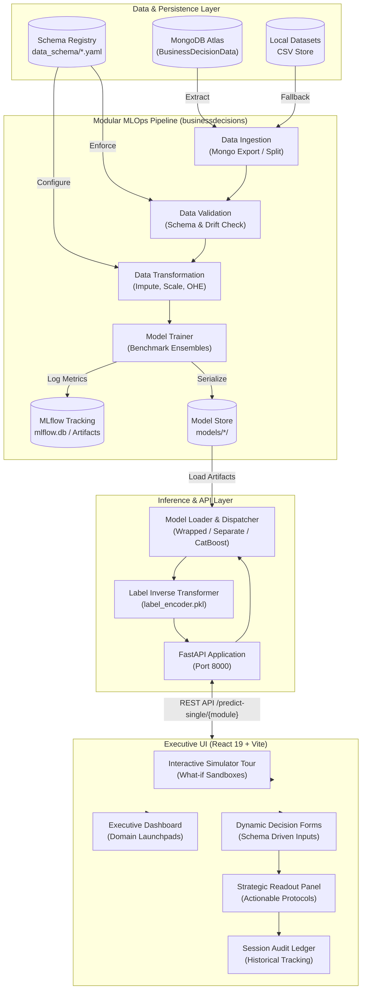

# STRATA: Strategic Business Decisions Platform
### *Enterprise Predictive Intelligence & Multi-Domain ML Decision Engine*

[](https://www.python.org/)
[](https://fastapi.tiangolo.com/)
[](https://react.dev/)
[](https://vitejs.dev/)
[](https://catboost.ai/)
[](https://scikit-learn.org/)
[](https://mlflow.org/)
[](https://www.mongodb.com/)
[](LICENSE)

---

## Executive Summary

**STRATA (Strategical Business Decisions)** is an end-to-end, enterprise-grade Decision Intelligence Platform designed to eliminate guesswork, spreadsheet silos, and intuition-based heuristics in high-stakes corporate operations. 

By unifying **production-ready machine learning pipelines**, a high-throughput **FastAPI microservice**, and a modern **React 19 executive command console**, STRATA delivers real-time predictive readouts, actionable strategic protocols, and automated session audit trails across four core business pillars:
1. **Customer Retention** (Churn hazard mitigation)
2. **Demand Forecasting & Pricing Intelligence** (SKU volume elasticity)
3. **Market Expansion & Venture Viability** (Capitalization & survival likelihood)
4. **Supply Chain Fulfillment Radar** (Transit SLA bottleneck prevention)

---

## Key Features

- **4 Specialized Domain Engines**: Custom-tailored feature stores, preprocessing pipelines, and ensemble models for churn, pricing, market expansion, and supply chain logistics.
- **Production MLOps Pipeline**: Modular stages for automated data ingestion from MongoDB Atlas, YAML schema validation, feature transformation (imputation, scaling, one-hot encoding), multi-model benchmarking, and serialized model artifact storage.
- **Experiment Tracking via MLflow**: Centralized metric logging (Precision, Recall, F1-Score, R², MAE, RMSE) and model registry with local SQLite backend.
- **High-Performance FastAPI Backend**: Sub-120ms inference latency, dynamic multi-format model loader (supporting Scikit-learn pipelines, separate preprocessors, and CatBoost `.cbm` engines), and automatic label inverse-transformation.
- **Executive React 19 Console**: Dark glassmorphic interface featuring interactive what-if sandbox simulators, dynamic schema-driven parameter forms, strategic intervention cards, and chronological session audit ledgers.
- **Zero-Leakage Architecture**: Isolated preprocessor artifacts and train/test splits with robust exception handling and comprehensive logging.

---

## The Four Decision Intelligence Engines

| Engine | Key | Problem Statement | Core Algorithm / Format | Primary Inputs | Decision Output & Protocol |
| :--- | :--- | :--- | :--- | :--- | :--- |
| **Customer Retention** | `churn` | *Will this customer cancel their service?* | Scikit-Learn / XGBoost Ensemble (`model.pkl` + `label_encoder.pkl`) | Tenure, contract type, monthly charges, tech support, online security, billing method | **Verdict**: At Risk / Likely to Stay<br>**Protocol**: Automated 12-month loyalty pricing incentive & priority retention escalation. |
| **Demand Forecasting** | `pricing` | *How many units will sell given price & promotion?* | CatBoost Regressor (`quantity_prediction_model.cbm`) | Base price, promo price, discount days, store area, format, department, date features | **Verdict**: Projected Unit Sales<br>**Protocol**: Optimal weekly SKU inventory buffering & price elasticity calibration. |
| **Market Expansion** | `market` | *Should we deploy capital into this venture/market?* | Multiclass Ensemble Classifier (`model.pkl` + `label_encoder.pkl`) | Funding rounds, total USD raised, investor backing (VC, Angel, Rounds A–D), milestones, location | **Verdict**: Acquired / Operating / Closed<br>**Protocol**: Venture syndicate validation & capital allocation score. |
| **Supply Chain Risk** | `supplychain` | *Will this shipment suffer delivery delay?* | Separate Preprocessor + Best Classifier (`best_model.pkl` + `preprocessor (2).pkl`) | Scheduled shipping days, shipping mode, order profit margin, discount rate, routing geolocations | **Verdict**: High Late-Delivery Risk / On-Time<br>**Protocol**: Bottleneck detection & automated expedited courier re-routing. |

---

## System Architecture



---

## Project Directory Structure

```text
business/
├── Artifacts/                      # Artifact outputs generated across pipeline runs
├── BusinessDecisionData/           # Raw tabular datasets (CSV sources)
│   ├── churn_data.csv              # Customer retention dataset
│   ├── market_data.csv             # Startup and market acquisition dataset
│   ├── pricing_data.csv            # Retail sales and pricing elasticity dataset
│   └── supplychain_data1.csv       # Supply chain shipment and logistics dataset
├── businessdecisions/              # Core Python ML package
│   ├── components/                 # Pipeline stages
│   │   ├── data_ingestion.py       # MongoDB extraction & feature store builder
│   │   ├── data_validation.py      # Schema enforcement & validation checks
│   │   ├── data_transformation.py  # ColumnTransformer, Imputer & Scaler logic
│   │   └── model_trainer.py        # Model benchmarking & MLflow tracking
│   ├── constant/                   # Pipeline constants and configurations
│   ├── entity/                     # Config entities and artifact entities
│   ├── exception/                  # Custom BusinessDecisionException handler
│   ├── logging/                    # Timestamped rotating logger
│   ├── pipeline/                   # Training pipeline orchestration
│   └── utils/                      # Main & ML utilities (metrics, serializers)
├── data_schema/                    # Domain YAML data schemas
│   ├── churn_schema.yaml           # Retention feature definitions
│   ├── market_schema.yaml          # Market feature definitions
│   ├── pricing_schema.yaml         # Pricing & demand feature definitions
│   └── supplychain_schema.yaml     # Logistics feature definitions
├── filesipynb/                     # Jupyter research and exploratory notebooks
├── frontend/
│   └── business_decision/          # React 19 + Vite web application
│       ├── public/                 # Static assets and icons
│       ├── src/
│       │   ├── components/
│       │   │   ├── Dashboard.jsx   # Executive overview & engine cards
│       │   │   ├── DecisionForm.jsx# Interactive dynamic input forms
│       │   │   ├── Landing.jsx     # Welcome tour & live what-if sandbox
│       │   │   ├── Overview.jsx    # Session audit ledger & stats
│       │   │   ├── ReadoutPanel.jsx# Model verdict & action protocol card
│       │   │   └── Sidebar.jsx     # Navigation sidebar
│       │   ├── api.js              # REST client for FastAPI endpoints
│       │   ├── App.jsx             # Shell routing and global history state
│       │   ├── moduleConfig.js     # Form field definitions & business logic
│       │   ├── styles.css          # Design system & dark glassmorphism styles
│       │   └── main.jsx            # React root entry point
│       ├── package.json            # Node dependencies
│       └── vite.config.js          # Vite build config
├── models/                         # Serialized production models
│   ├── churn/                      # model.pkl, preprocessing.pkl, label_encoder.pkl
│   ├── market/                     # model.pkl, preprocessing.pkl, label_encoder.pkl
│   ├── pricing/                    # quantity_prediction_model.cbm (CatBoost)
│   └── supplychain/                # best_model.pkl, preprocessor.pkl, label_encoder.pkl
├── .env                            # Environment variables (MongoDB connection URI)
├── .gitignore                      # Git exclusion rules
├── app.py                          # FastAPI backend application & routing
├── main.py                         # Master training pipeline trigger CLI
├── mlflow.db                       # Local SQLite database for MLflow runs
├── push_data.py                    # ETL script: Ingest raw CSV data into MongoDB
├── requirements.txt                # Python backend dependencies
└── setup.py                        # Pip package distribution configuration
```

---

## Machine Learning & MLOps Lifecycle

The platform follows a rigorous, decoupled MLOps architecture:

```
[ Raw CSV / MongoDB ] ──> [ Ingestion ] ──> [ Validation ] ──> [ Transformation ] ──> [ Model Trainer ] ──> [ MLflow & Disk ]
```

### 1. Data Ingestion
- Handled by `push_data.py` (ETL) and `businessdecisions/components/data_ingestion.py`.
- Connects securely to MongoDB Atlas using `MONGO_DB_URL` with SSL certifi verification.
- Exports database records into local feature stores with automatic train/test splits (default: 80/20).

### 2. Schema-Driven Data Validation
- Validates columns, data types, and presence of target labels using YAML definitions in `data_schema/`.
- Segregates data into `validated` and `invalid` directories to prevent downstream model corruption.

### 3. Transformation & Feature Engineering
- **Numerical Features**: Median imputation via `SimpleImputer` followed by normalization with `StandardScaler`.
- **Categorical Features**: Mode imputation followed by `OneHotEncoder(handle_unknown='ignore')`.
- Target labels are transformed using `LabelEncoder` with encoders persisted for post-prediction decoding.

### 4. Model Training & Evaluation
- Benchmarks multiple candidate algorithms:
  - **Classification**: Random Forest, Gradient Boosting, AdaBoost, Logistic Regression, Decision Trees.
  - **Regression**: Random Forest Regressor, Gradient Boosting Regressor, Decision Tree Regressor, Linear Regression.
- Automated selection of the highest-performing model based on cross-validation scores.

### 5. Experiment Tracking with MLflow
- Automatically logs all training runs to `mlflow.db`.
- Tracks hyperparameters, model artifacts, and evaluation metrics:
  - **Classification**: F1-Score, Precision, Recall.
  - **Regression**: R², MAE, RMSE.

---

## REST API Documentation

The backend service is powered by **FastAPI** (`app.py`), providing interactive documentation at `http://localhost:8000/docs`.

### Primary Endpoints

#### 1. Real-Time Single Prediction
`POST /predict-single/{module_name}`  
*Supported modules:* `churn`, `pricing`, `market`, `supplychain`

**Request Example (`churn`):**
```bash
curl -X POST "http://localhost:8000/predict-single/churn" \
     -H "Content-Type: application/json" \
     -d '{
       "data": {
         "gender": "Female",
         "SeniorCitizen": 0,
         "Partner": "Yes",
         "Dependents": "No",
         "tenure": 3,
         "PhoneService": "Yes",
         "MultipleLines": "No",
         "InternetService": "Fiber optic",
         "OnlineSecurity": "No",
         "OnlineBackup": "No",
         "DeviceProtection": "No",
         "TechSupport": "No",
         "StreamingTV": "Yes",
         "StreamingMovies": "Yes",
         "Contract": "Month-to-month",
         "PaperlessBilling": "Yes",
         "PaymentMethod": "Electronic check",
         "MonthlyCharges": 89.85,
         "TotalCharges": 269.55
       }
     }'
```

**Response Example:**
```json
{
  "module": "churn",
  "prediction": "Yes",
  "input": {
    "gender": "Female",
    "tenure": 3,
    "Contract": "Month-to-month",
    "MonthlyCharges": 89.85
  }
}
```

#### 2. Batch File Prediction
`POST /predict-batch/{module_name}`  
Upload a CSV file and receive an HTML preview table of predictions, with full results written to `prediction_output/{module}_output.csv`.

---

## Getting Started

### Prerequisites

- **Python**: Version 3.10, 3.11, or 3.12
- **Node.js**: Version 18.x or newer & `npm`
- **MongoDB**: Active MongoDB Atlas cluster or local MongoDB instance

---

### Step 1: Clone & Configure Environment

1. Clone the repository:
   ```bash
   git clone <repository_url>
   cd business
   ```

2. Create a `.env` file in the project root:
   ```env
   MONGO_DB_URL=mongodb+srv://<username>:<password>@<cluster>.mongodb.net/?retryWrites=true&w=majority
   ```

---

### Step 2: Python Backend Setup

1. Create and activate a virtual environment:
   ```bash
   # Windows (PowerShell)
   python -m venv venv
   .\venv\Scripts\Activate.ps1

   # Linux / macOS
   python3 -m venv venv
   source venv/bin/activate
   ```

2. Install Python dependencies:
   ```bash
   pip install -r requirements.txt
   ```

3. (Optional) Ingest raw CSV data into MongoDB:
   ```bash
   python push_data.py
   ```

---

### Step 3: Run the ML Training Pipeline

Train all 4 business models sequentially:
```bash
python main.py
```

Or trigger an individual module pipeline:
```bash
python main.py churn
python main.py pricing
python main.py market
python main.py supplychain
```

To inspect experiment metrics via MLflow UI:
```bash
mlflow ui --backend-store-uri sqlite:///mlflow.db
```
*Navigate to `http://localhost:5000` to compare runs, parameters, and loss curves.*

---

### Step 4: Launch the FastAPI Backend Service

```bash
python app.py
```
*The API server starts at `http://localhost:8000`. Swagger documentation is available at `http://localhost:8000/docs`.*

---

### Step 5: Launch the React Frontend Console

1. Navigate to the frontend directory:
   ```bash
   cd frontend/business_decision
   ```

2. Install npm packages:
   ```bash
   npm install
   ```

3. Start the Vite development server:
   ```bash
   npm run dev
   ```

4. Open your browser and navigate to:
   ```
   http://localhost:5173
   ```

---

## Executive Frontend Interface

The frontend provides an intuitive, high-density decision environment:
- **Interactive Simulator**: Test sensitivity analysis with live sliders for immediate outcome simulations before sending production API requests.
- **Console Navigation**: Seamless switching between the 4 decision engines with domain-specific accent indicators and real-time backend health pings.
- **Strategic Action Cards**: Every prediction is paired with a concrete business protocol (e.g. loyalty pricing, carrier re-routing, demand buffering).
- **Session Audit Ledger**: Review all evaluations performed during the session with filtering by domain, high-risk flags, and copyable audit summaries.

---

## Tech Stack Summary

- **Backend**: Python, FastAPI, Uvicorn, Pydantic, Jinja2
- **Data Science & ML**: CatBoost, XGBoost, Scikit-Learn, Pandas, NumPy, Imbalanced-Learn
- **Experiment Tracking**: MLflow (SQLite backend)
- **Database & Storage**: MongoDB Atlas, YAML, Pickle / Dill, Joblib
- **Frontend**: React 19, Vite, Modern CSS3 with Design Tokens, ESLint

---

## Author & Maintainer

**Bidipta Mallik**  
Email: [bidiptamallik0@gmail.com](mailto:bidiptamallik0@gmail.com)  
Project: *Strategical Business Decisions (STRATA)*

---

## License

This project is licensed under the [MIT License](LICENSE) - see the LICENSE file for details.
